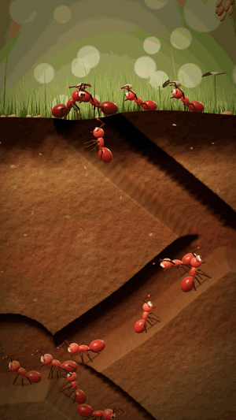

# Ant farm

A living ant colony for a spare screen, drawn live in 3D. A cut-away of an ant nest seen face on, with the meadow
above it: cartoon ants dig their tunnels and rooms, carry the spoil up to a growing mound, bring seeds and pieces of
leaf home to the granary and the leaf garden, look after the queen and the brood, and sleep in the rest rooms. They
meet and touch antennae, clean themselves and now and then sit down for a stretch. A ladybird, a beetle or a
caterpillar wanders across the meadow from time to time, and day and night follow your clock.

The colony starts with a queen and four workers and grows as the brood hatches. The nest takes about two days to dig,
then a new colony starts.

It can follow your computer's load: the busier the machine, the more ants are awake and the faster they work.

**Live demo:** https://cvcwebsolutions.github.io/ant-farm/

## Run it

No build step: `index.html`, `colony.js` and three.js in `vendor/`. It needs a browser with WebGL.

- **Just watch:** open the live demo, or serve this folder with any static web server
  (`python3 -m http.server`, then http://localhost:8000/). The colony is saved in your browser, and without a load
  source the ants keep a gentle rhythm of their own.
- **Follow your machine's load:** run `python3 server.py` (Python 3.8+, standard library only) and open
  http://127.0.0.1:8978/. It reads CPU use (and NVIDIA GPUs, if `nvidia-smi` is installed) and keeps the colony in
  `./state/`, so it survives browser restarts.

URL options: `?fps=60`, `?heat=0.8` (fixed activity 0..1), `?demo=1` (activity sweeping up and down),
`?fresh=1&seed=7&grow=0.6` (a new colony, 60 % dug, nothing saved), `?hour=21` (a fixed time of day),
`?shot=queen` (the camera stays on one kind of view: `entrance`, `meadow`, `queen`, `granary`, `brood`, `rest`, `dig`, `close`,
`follow`, `wide`), `?dpr=0.75` (render at a lower resolution for a slow GPU).

## As an always-on screen

Any browser in full-screen or kiosk mode works, for example
`chromium --kiosk --noerrdialogs --disable-session-crashed-bubble http://127.0.0.1:8978/` or Firefox with `--kiosk`.
It was made for a small portrait case screen (1080x1920) and fits any size. It draws at 30 fps by default; on a weak
integrated GPU add `?dpr=0.75`.

## The 2D farm

The first version, a glass formicarium in Canvas 2D with harvester ants digging the sand grain by grain, is in
[`2d/`](2d/) (demo: https://cvcwebsolutions.github.io/ant-farm/2d/). It's one HTML file, very light on the CPU, and
works with the same `server.py` at http://127.0.0.1:8978/2d/.

## Licence

MIT, © 2026 CVC Web Solutions. See [LICENSE](LICENSE) and [SOURCES.md](SOURCES.md). Everything here is drawn by code:
there are no image or model assets, and nothing is AI-generated.
