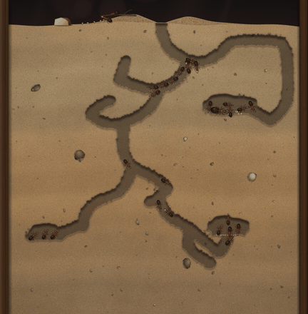
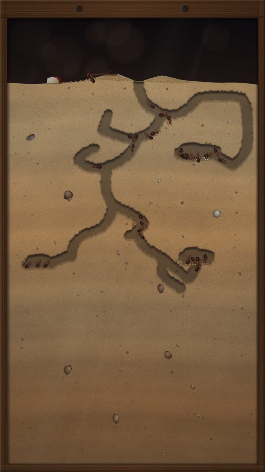

# Ant farm

A living ant farm for a spare screen. A harvester-ant colony digs its nest in a glass formicarium, grain by grain:
workers tunnel and carry the spoil up to a growing mound, foragers bring seeds down to the granary, nurses tend the
queen and the brood, and the rest sleep in the chambers. The nest takes about two days to fill the farm, then a new
colony starts.

It can follow your computer's load: the busier the machine, the more ants are awake and the faster they dig.

**Live demo:** https://cvcwebsolutions.github.io/ant-farm/

## Run it

It's one HTML file with no dependencies and no build step.

- **Just watch:** open the live demo, or serve this folder with any static web server
  (`python3 -m http.server`, then http://localhost:8000/). The colony is saved in your browser, and without a load
  source the ants keep a gentle rhythm of their own.
- **Follow your machine's load:** run `python3 server.py` (Python 3.8+, standard library only) and open
  http://127.0.0.1:8978/. It reads CPU use (and NVIDIA GPUs, if `nvidia-smi` is installed) and keeps the colony in
  `./state/`, so it survives browser restarts.

URL options: `?fps=60`, `?heat=0.8` (fixed activity 0..1), `?demo=1` (activity sweeping up and down),
`?fresh=1&seed=7&grow=0.6` (a new farm, 60 % dug, nothing saved).

## As an always-on screen

Any browser in full-screen or kiosk mode works, for example
`chromium --kiosk --noerrdialogs --disable-session-crashed-bubble http://127.0.0.1:8978/` or Firefox with `--kiosk`.
It was made for a small portrait case screen (1080x1920) and fits any size. It draws with Canvas 2D and repaints only
around the ants, so it's light on the CPU (30 fps by default).

## Licence

MIT, © 2026 CVC Web Solutions. See [LICENSE](LICENSE). Everything here is drawn by code: there are no image or model
assets.
